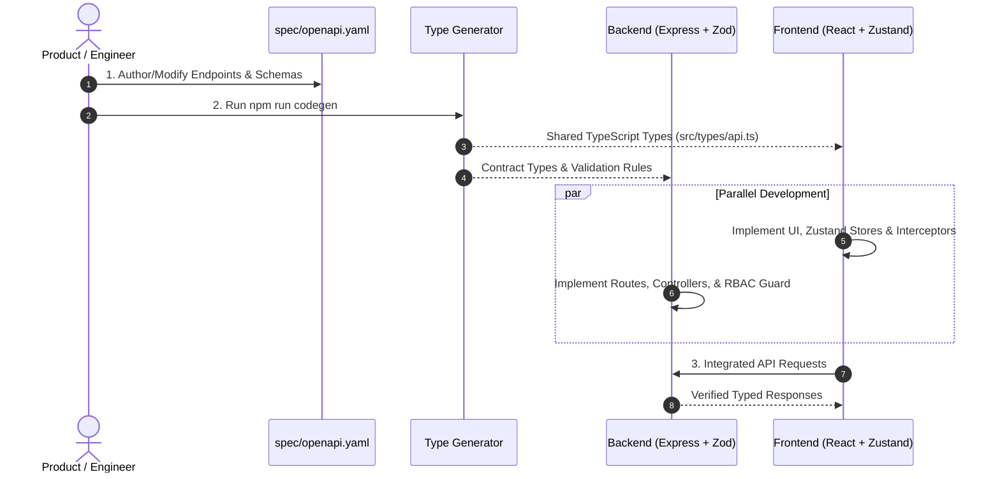

# Spec-Driven Development (SDD) Workflow Guide

## 1. Core Philosophy: The Contract is Law
In Spec-Driven Development (SDD), the API specification (`spec/openapi.yaml`) is the single source of truth. No code is written before the specification is defined, reviewed, and validated.

### Benefits
- **Zero Drift**: Eliminates discrepancies between frontend expectations and backend responses.
- **Parallel Engineering**: Frontend engineers can mock the exact contract and build interfaces while backend engineers implement the database models and services.
- **Auto-generated Types**: TypeScript interfaces for request bodies, query params, and DTOs are compiled directly from the OpenAPI schema.
- **Instant Documentation**: Backend hosts Swagger UI directly at `/docs` reflecting live contracts.

---

## 2. SDD Lifecycle Diagram



---

## 3. RBAC Matrix (Role-Based Access Control)

The system supports hierarchical roles and fine-grained permissions.

### Role Hierarchy
$$\text{ADMIN} \supset \text{MANAGER} \supset \text{USER}$$

| Role | Default Permissions | Scope & Capabilities |
| :--- | :--- | :--- |
| **`ADMIN`** | `users:read`, `users:write`, `analytics:read`, `system:admin` | Full system control. Can view all users, promote/demote roles, inspect system health, and access all dashboards. |
| **`MANAGER`** | `users:read`, `analytics:read` | Team oversight. Can view user rosters and audit analytics, but cannot change user roles or modify system config. |
| **`USER`** | `profile:read`, `profile:write`, `analytics:read` | Standard member. Can authenticate, update personal profile, and access personal dashboard metrics. |

---

## 4. Developer Runbook: Step-by-Step

### Adding a New Endpoint (Example: `POST /api/v1/projects`)
1. **Define in Spec**: Open `spec/openapi.yaml`. Define path, HTTP method, `tags`, `security`, `requestBody`, and `responses` (with 200/201 and 400/401/403 error schemas).
2. **Generate Types**: Run:
   ```bash
   npm run codegen
   ```
3. **Backend Implementation**:
   - Create Zod schema in `backend/src/modules/projects/project.schema.ts` matching the spec.
   - Add route with authentication and RBAC guards:
     ```typescript
     router.post('/', authenticate, requirePermission('projects:write'), validate(createProjectSchema), projectController.create);
     ```
   - Implement business logic in `project.service.ts`.
4. **Frontend Implementation**:
   - Consume typed function or hook in `frontend/src/api/projects.ts`.
   - Update Zustand store / UI components with full type safety and autocomplete.
5. **Verify**:
   - Open `http://localhost:4000/docs` to test interactively via Swagger UI.
   - Run integration tests (`npm test`).
